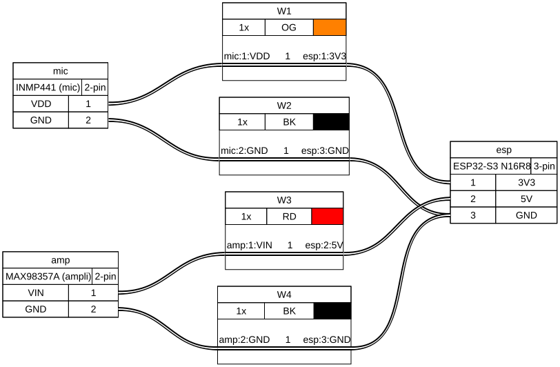
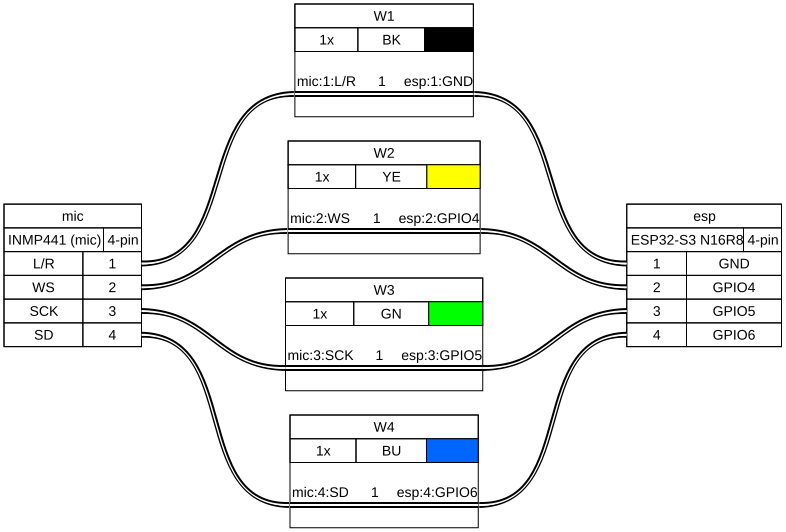
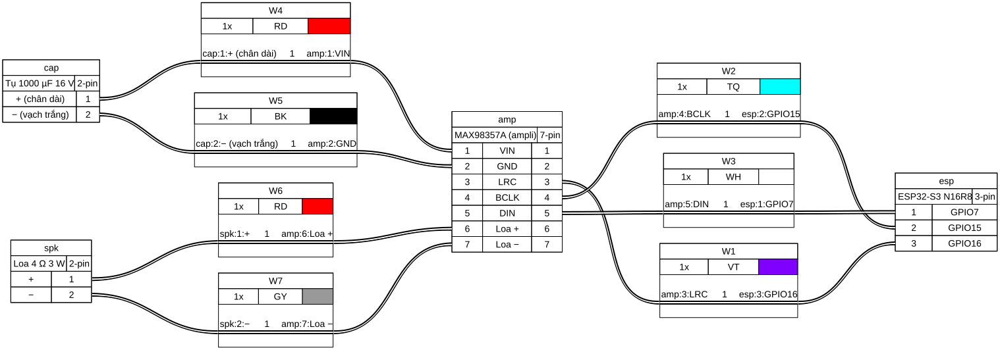
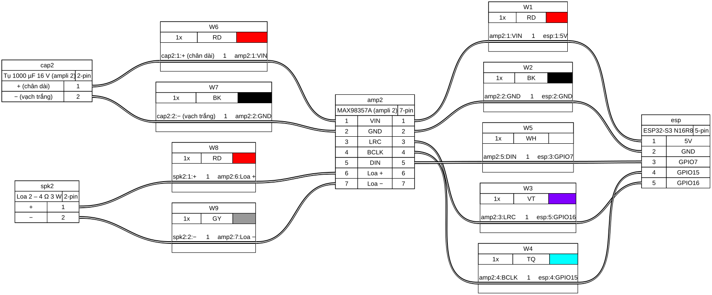
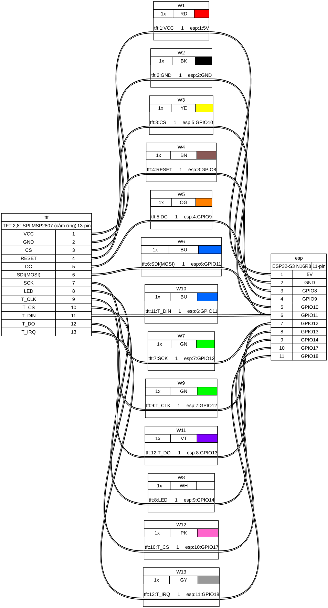
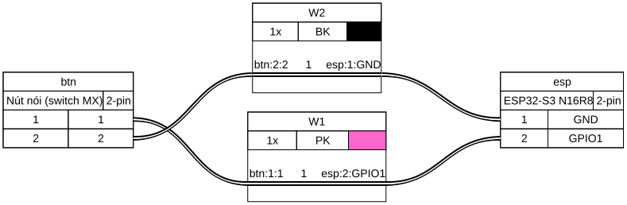

# Cú Bông S3 – hàn và đấu dây (bản có màn + 2 loa, 2026-11-26)

Bo ESP32-S3 N16R8 (đã đọc chip 2026-11-12: rev v0.2, PSRAM 8 MB, flash 16 MB); mic INMP441; 2 × MAX98357A + 2 loa Ø52 4 Ω 3 W ở 2 sườn quay ngang (H0); màn TFT 2,8" SPI cảm ứng MSP2807 làm mắt; 1 nút nói switch MX.
Nguồn chân: `wiring-s3.yaml` (Toolhub vẽ hình từ file này). Đổi chân phải sửa yaml + file này + `firmware/xiaozhi-s3/boards/stlab-s3/config.h`.

## 1. An toàn – đọc trước khi hàn

- **INMP441 chỉ 3,3 V.** Cấp 5 V có thể hỏng mic.
- **MAX98357A cấp 5 V**, không lấy từ chân 3V3 của bo.
- **Dây loa (+ và −) không nối GND.** Ngõ ra ampli là kiểu cầu; chạm GND là chập ampli.
- **Mỗi loa 1 ampli.** Không nối 2 loa song song vào 1 ampli (2 Ω quá tải).
- **Tụ hóa có cực.** Chân dài (+) vào VIN, chân ngắn có vạch trắng (−) vào GND. Cắm ngược có thể phồng, nổ.
- **Chân tín hiệu màn chỉ chịu 3,3 V.** ESP32-S3 ra 3,3 V nên nối thẳng được, không qua mạch 5 V.
- **VCC màn 5 V thì J1 trên màn phải HỞ** (U2 hạ 3,3 V). TODO: kiểm trước khi cấp điện.
- **Kính màn mỏng, không có tấm che.** Hàn và lắp tránh đè lên kính.
- **Rút USB khi hàn.** Mỏ hàn 330–350 °C, hàn xong để nguội, không chạm đầu mỏ.
- **Nguồn 5 V ≥ 2 A** (2 ampli phát to + màn + bo). Cổng USB máy tính 0,5–0,9 A KHÔNG đủ.
- **Âm lượng thử ≤ 70.**

## 2. Chuẩn bị

| Món | Số lượng |
|---|---|
| ESP32-S3 N16R8 | 1 |
| Module INMP441 | 1 |
| Module MAX98357A | 2 (mỗi loa 1 module) |
| Loa Ø52 × 26 mm, 4 Ω 3 W | 2 |
| Tụ hóa 1000 µF 16 V | 2 (mỗi ampli 1 tụ) |
| Màn TFT 2,8" SPI cảm ứng MSP2807 | 1 |
| Switch MX (nút nói) | 1 |
| Vít M2.5 × 6 | **12**: 4 bắt PCB màn vào khung, 4 bắt khung màn vào vỏ (lắp từ trong), 4 bắt 2 khay ampli xuống tấm đế (2/khay) |
| Băng xốp 2 mm | vòng mặt loa (2 cái) |
| Dây điện mềm | hàn thẳng toàn bộ, không jack, không cầu đấu (Tuan 2026-11-18) |

## 3. Bảng chân tổng (theo GPIO)

| GPIO | Chức năng | Ghi chú |
|---|---|---|
| 0 | BOOT | Nút có sẵn trên bo; dùng thử trên bàn |
| 1 | Nút nói | Switch MX: GPIO1 → nút → GND |
| 4 | Mic WS | INMP441 |
| 5 | Mic SCK | INMP441 |
| 6 | Mic SD | INMP441 |
| 7 | DIN ampli | Chung cho 2 ampli |
| 8 | RESET màn | |
| 9 | DC màn | |
| 10 | CS màn | |
| 11 | MOSI màn + T_DIN | Chung cho hiển thị và cảm ứng |
| 12 | SCK màn + T_CLK | Chung cho hiển thị và cảm ứng |
| 13 | T_DO | Cảm ứng |
| 14 | LED đèn nền màn | PWM |
| 15 | BCLK ampli | Chung cho 2 ampli |
| 16 | LRC ampli | Chung cho 2 ampli |
| 17 | T_CS | Cảm ứng |
| 18 | T_IRQ | Cảm ứng |
| 48 | LED trên bo | |

- **Không dùng** GPIO35, 36, 37 (PSRAM của bo N16R8).
- **Không dùng** GPIO19, 20 (USB).
- **Chân khởi động:** GPIO0, 3, 45, 46. GPIO0 chỉ dùng nút BOOT có sẵn.
- **Bo clone:** đọc chữ in cạnh chân trước khi hàn; vị trí chân có thể khác bo gốc.

## 4. Sơ đồ đấu dây (hình)

Vẽ tự động từ `wiring-s3.yaml` (giống trang Toolhub). Vị trí chân trên hình là sơ đồ nguyên lý – khi hàn đọc chữ in cạnh chân trên bo.








## 5. Đấu từng module

### 5.1 INMP441 (mic)

| INMP441 | ESP32-S3 | Ghi chú |
|---|---|---|
| VDD | 3V3 | Chỉ 3,3 V |
| GND | GND | |
| L/R | GND | Bắt buộc nối, không để trống (chọn kênh trái) |
| WS | GPIO4 | |
| SCK | GPIO5 | |
| SD | GPIO6 | |

### 5.2 MAX98357A – ampli 1, loa TRÁI

| MAX98357A | ESP32-S3 / loa | Ghi chú |
|---|---|---|
| VIN | 5V | 5 V, không lấy từ 3V3 |
| GND | GND | |
| LRC | GPIO16 | |
| BCLK | GPIO15 | |
| DIN | GPIO7 | |
| GAIN | để trống | |
| SD | để trống | |
| Loa + / Loa − | 2 dây loa trái | **KHÔNG nối GND** |

### 5.3 MAX98357A – ampli 2, loa PHẢI

| MAX98357A | ESP32-S3 / loa | Ghi chú |
|---|---|---|
| VIN | 5V | Chung 5V với ampli 1 |
| GND | GND | |
| LRC | GPIO16 | Chung dây với ampli 1 |
| BCLK | GPIO15 | Chung dây với ampli 1 |
| DIN | GPIO7 | Chung dây với ampli 1 |
| GAIN | để trống | GAIN nối GND = 12 dB, to hơn, CHƯA thử. Đánh đổi: vọng vào mic nhiều hơn |
| SD | để trống | |
| Loa + / Loa − | 2 dây loa phải | **KHÔNG nối GND** |

### 5.4 Tụ 1000 µF 16 V (mỗi ampli 1 tụ)

Hàn tụ sát chân VIN và GND của module MAX98357A (không đặt ở đầu bo ESP32):

```text
  Bo ESP32-S3 5V ───────────┬──────── VIN  (MAX98357A)
                            │
                          ( + )   chân dài, phía KHÔNG có vạch
                         [ 1000 µF ]
                          ( − )   chân ngắn, phía có VẠCH trắng
                            │
  Bo ESP32-S3 GND ──────────┴──────── GND  (MAX98357A)
```

- Ngược cực = tụ có thể phồng, nổ. Kiểm vạch trắng nằm phía GND trước khi cắm điện.

### 5.5 Màn TFT 2,8" MSP2807

Header 14 chân bước 2,54 mm nằm ở đầu phía +x của màn.

| Màn TFT | ESP32-S3 | Ghi chú |
|---|---|---|
| VCC | 5V | J1 trên màn để HỞ (U2 hạ 3,3 V). TODO kiểm |
| GND | GND | |
| CS | GPIO10 | |
| RESET | GPIO8 | |
| DC | GPIO9 | |
| SDI (MOSI) | GPIO11 | |
| SCK | GPIO12 | |
| LED | GPIO14 | Đèn nền, PWM |
| SDO (MISO) | để trống | |
| 4 chân SD (khe thẻ) | để trống | |
| T_CLK | GPIO12 | Chung SCK |
| T_DIN | GPIO11 | Chung MOSI |
| T_DO | GPIO13 | |
| T_CS | GPIO17 | |
| T_IRQ | GPIO18 | |

### 5.6 Nút nói

- Switch MX: GPIO1 → nút → GND. Chạm để bắt đầu/kết thúc nói; chạm lúc cô đang nói là ngắt lời; giữ 5 s là ngủ.
- Nút BOOT GPIO0 dùng để thử trên bàn. Khi lắp vào vỏ, BOOT bị che.
- Vỏ không có nút âm lượng (GPIO39/40 bỏ). Chỉnh âm lượng bằng giọng nói.

## 6. Vị trí trong vỏ

Số đo lấy từ `cad/README.md`, mục "Bản có màn + 2 loa".

- **Màn**: mặt trước, header về +x. Giữ bằng 4 vít M2.5 × 6 vào khung mặt trước.
- **Mic**: ở trán, nghiêng 45°. PCB mic dán keo nóng. Lỗ âm Ø4 mm, không bịt.
- **2 loa**: 2 sườn, ngàm xoay + gờ Ø48 mm + băng xốp 2 mm.
- **2 khay ampli**: dưới bo S3, giữa 2 ray; mỗi khay 2 vít M2.5 × 6 xuống tấm đế.
- **Bo S3**: nằm ngang, cổng USB-C ra lưng.
- **Đi dây**: dây I2S ≤ 15 cm; dây SPI màn ≤ 10 cm (nhiễu → hạ xung SPI 40 → 20 MHz). Dây loa chạy dọc sàn, không kẹp vào mặt ráp 2 nửa vỏ.

## 7. Nguồn

- Hiện dùng sạc qua cổng USB-C của bo. Cần ≥ 2 A.
- TODO: kiểm diode trên đường 5V của bo S3. Nếu bo tự khởi động lại khi loa to (log `brownout`), cấp 5 V cho 2 ampli thẳng từ nguồn ngoài, GND chung.
- Pin sạc sau này: chưa thiết kế (cell có mạch bảo vệ, mạch sạc/tăng áp 5 V, ngăn pin bắt vít).

## 8. Kiểm tra trước khi cắm điện

1. Đồng hồ thang thông mạch: **5V – GND** và **3V3 – GND** phải **không** kêu.
2. Kiểm từng dây theo bảng mục 5 (đầu này – đầu kia kêu).
3. Loa + / Loa − không thông với GND.
4. J1 trên màn đang hở.
5. Mỗi ampli đúng 1 loa.
6. Chân tín hiệu màn không chạm 5V.
7. Cắm USB: đèn nguồn bo sáng, không mùi khét, linh kiện không nóng tay. Bất thường → rút ngay.

## 9. Thử

- Bấm BOOT → cô chào → nói "Hello" → cô trả lời.
- Lúc cô đang nói, nói chen "Cô ơi!" → cô dừng và nghe.
- 2 loa đều kêu (nghe từng bên).
- Bo tự khởi động lại khi loa to (log `brownout`) → cấp 5 V riêng cho ampli qua nguồn ngoài, GND chung.
- Cô tự ngắt lời khi không ai nói → tiếng vọng lọt: đưa mic xa loa hơn, báo Claude chỉnh `STLAB_AEC_REF_DELAY_MS`.
- Màn và cảm ứng: firmware CHƯA có driver. Tạm thời chỉ kiểm đèn nền sáng khi GPIO14 lên mức cao. TODO khi có firmware: chip ST7789 hay ILI9341, thử cả 2.
