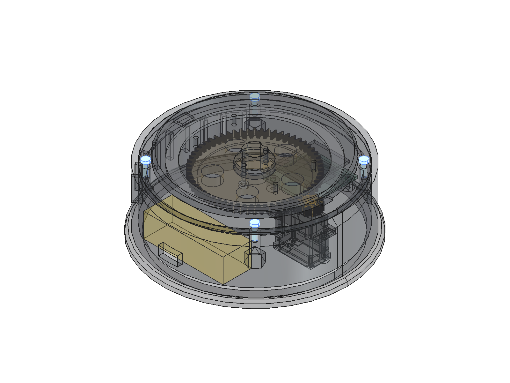
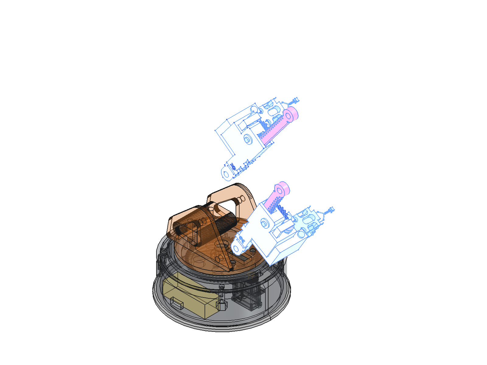
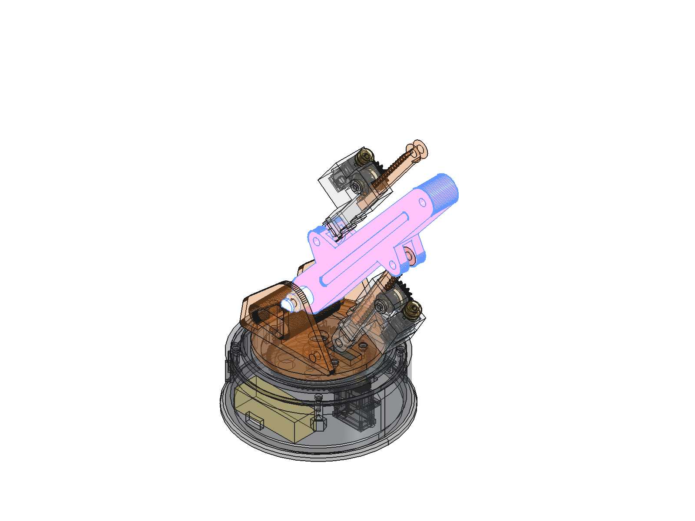
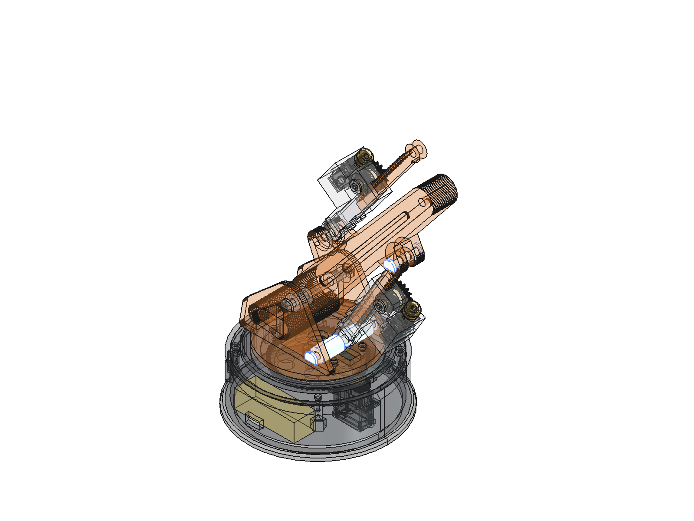
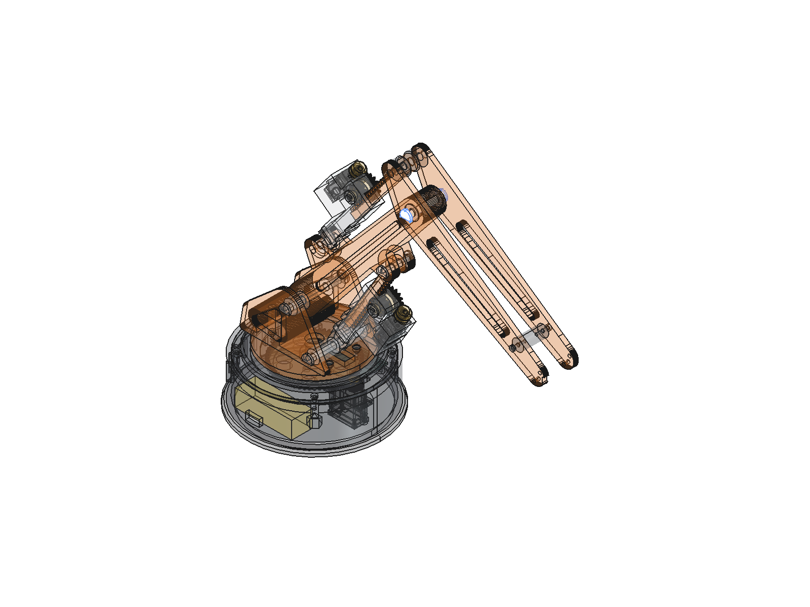
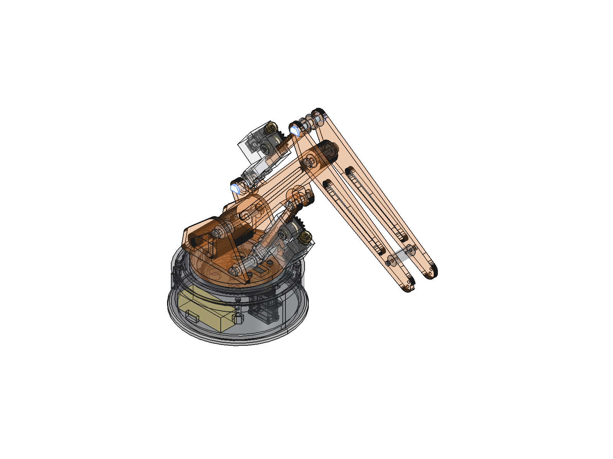
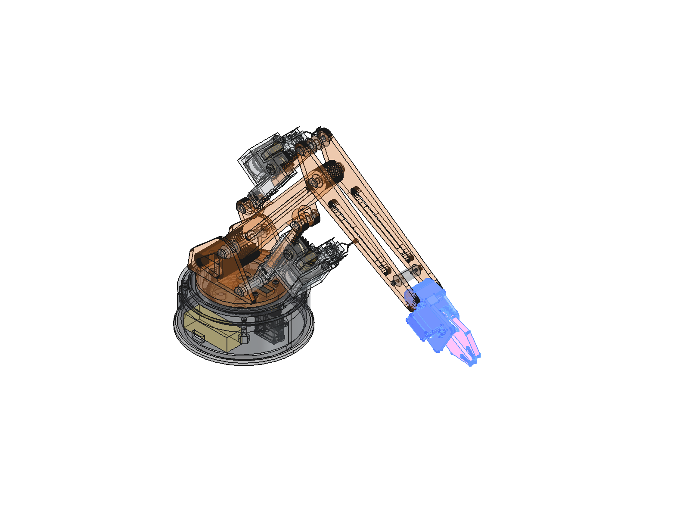

# Hướng dẫn lắp ráp – Cánh tay robot xi-lanh đẩy (pushrod-arm)

Dành cho học sinh từ lớp 6, làm cùng thầy/cô. Viết lại 2026-10-25 từ model hiện tại (`freecad/pushrod_arm.FCStd`):
34 bước, mỗi bước **một việc**. Ảnh: `freecad/images/assembly/step-XX-{c,a,b}.png` – tạo lại bằng
`freecad/scripts/render_assembly_steps.py` (chạy qua `maker/robotics-cad/scripts/gui_run.py`). PDF:
`python maker/robotics-cad/scripts/assembly-pdf.py maker/pushrod-arm/ASSEMBLY.md`.

## Trước khi bắt đầu

**Cách đọc mỗi bước**
- **Cần lấy**: chi tiết và số lượng. "Bàn P2" = chi tiết in ở bàn in P2. "Mua" = linh kiện mua sẵn.
- 3 ảnh: **Chuẩn bị** (chỉ các chi tiết cần lấy) → **Lắp xong** (chi tiết mới màu xanh, phần đã lắp mờ) → **Phóng to**.
- **Kiểm tra**: làm đúng thì mới sang bước sau.
- **[Cần người lớn]**: gọi thầy/cô cùng làm.

**An toàn**
- **Chưa cắm pin, chưa cấp điện** cho đến khi lắp xong và thầy/cô kiểm tra.
- Pin Li-ion (pin CyberBrick PC003, 7,4 V): **không đâm, ép, làm nóng**; chỉ sạc bằng bộ sạc đúng loại, có người lớn trông.
  Dung lượng ghi khác nhau (800 / 700 mAh) – đọc nhãn trên pin thật.
- Không dùng dao rọc giấy một mình. Gỡ support/ba-via bằng kìm, hướng lưỡi ra xa tay.
- Gỡ chi tiết PETG khỏi bàn in khi **bàn đã nguội** (PETG dính chặt).

**Dụng cụ**
- **Lục giác 2 mm** – mọi vít là **M2.5 đầu trụ lục giác chìm** (ISO 4762 / DIN 912, mũ Ø4,5 mm như trong model).
  Vít tự ren vào lỗ nhựa Ø2,2 mm: vặn chậm, **vừa tay**, siết quá sẽ toét ren nhựa.
- Kìm mũi nhọn, giấy nhám mịn, thước kẹp (hoặc thước kẻ), hộp nhỏ để chia vít.
- **Băng dính xốp 2 mặt** (loại dày ~1 mm), **keo 502** (chỉ người lớn dùng), dây rút nhỏ.

**Vít cần** (xếp riêng từng loại vào hộp, ghi nhãn):
| Vít | Số lượng |
|---|---|
| M2.5 × 6 | 21 |
| M2.5 × 8 | 4 |
| M2.5 × 10 | 2 |
| M2.5 × 16 | 4 |

**Số khớp – chốt cùng số lắp với nhau**
| Số | Chốt | Nối | Bước |
|---|---|---|---|
| 1 | S | Tháp (turret) ↔ Cần chính (Boom) | 18 |
| 2 | A | Tháp ↔ Xi-lanh vai | 19 |
| 3 | B | Cần chính ↔ Thanh răng vai | 20 |
| 4 | E | Cần chính ↔ Cẳng tay | 23 |
| 5 | C | Cần chính ↔ Xi-lanh khuỷu | 24 |
| 6 | D | Cẳng tay ↔ Thanh răng khuỷu | 25 |
Chi tiết in trước 2026-10-24 chưa có số khắc → dùng bút lông ghi số cạnh lỗ chốt theo bảng.

**Thử chốt trước**: mỗi chốt (bàn P8, thân Ø4,8 mm) phải **xoay trơn bằng tay** trong lỗ. Chặt thì chà nhẹ giấy nhám –
không đóng, không ép mạnh.

**Thứ tự**: A. Đế (1–6) → B. Mâm xoay (7–10) → C. Tháp (11) → D. Xi-lanh vai (12–14) → E. Xi-lanh khuỷu (15–17)
→ F. Cần chính (18–20) → G. Cẳng tay (21–25) → H. Động cơ (26–28) → I. Kẹp (29–34).

## Bước 1 – Chân đế và vỏ đế
**Cụm A – Đế**
**Cần lấy:** vỏ đế `Base_housing` ×1, chân đế `Base_foot` ×1 (bàn P1).

1. Đặt chân đế xuống bàn.
2. Đặt vỏ đế lên trên chân đế, khớp vành tròn.

3. Chân đế và vỏ không có vít: dán **4 miếng băng dính xốp 2 mặt** (khoảng 15 × 15 mm) ở 4 góc mặt trên chân đế rồi ấn
   vỏ xuống. Muốn dính chắc hẳn: thầy/cô dán bằng keo 502.

**Kiểm tra:** vỏ đế nằm phẳng, không lệch; nhấc vỏ thì chân đế lên theo.

## Bước 2 – Đặt khối pin
**Cụm A – Đế**
**Cần lấy:** khối pin (`Battery_bay`) ×1 – **mua**: pin CyberBrick **PC003** (Li-ion 2S 7,4 V; mạch XA004 nhận 7,4–12,6 V).

1. Dán 1 miếng băng dính xốp 2 mặt dưới đáy khối pin.
2. Đặt khối pin vào ngăn trong vỏ đế như ảnh, ấn xuống cho dính (phía trên ngăn pin còn trống, không có gì chặn).
3. **Chưa** nối dây pin.

**Kiểm tra:** khối pin nằm gọn, không cấn thành vỏ.

## Bước 3 – Bốn ống nâng bộ thu
**Cụm A – Đế**
**Cần lấy:** ống nâng `Receiver_riser` ×4 (bàn P2, cao 9,7 mm).

1. Đặt 4 ống nâng lên 4 trụ nhỏ trong vỏ đế.

**Kiểm tra:** cả 4 ống đứng thẳng, lỗ ống trùng lỗ trụ.

## Bước 4 – Bộ thu CyberBrick [Cần người lớn]
**Cụm A – Đế**
**Cần lấy:** bộ thu XA003 + mạch XA004 ghép sẵn ×1 (**mua**), vít **M2.5 × 16** ×4.

1. Lõi XA003 cắm ở **mặt dưới** mạch XA004; hàng chân cắm servo **hướng lên**.
2. Đặt bộ thu lên 4 ống nâng – lõi XA003 lọt vào giữa 4 ống.
3. Bắt 4 vít M2.5 × 16 qua lỗ mạch, qua ống, vào trụ. Vặn vừa tay, không siết mạnh (nứt mạch).
   (Vít ăn vào trụ 4,6 mm; vít ngắn hơn ×14 chỉ ăn 2,6 mm – lỏng.)

**Kiểm tra:** không đặt mạch thẳng lên trụ (lõi sẽ cấn đáy vỏ); cắm được dây servo từ phía trên.

## Bước 5 – Servo xoay đế
**Cụm A – Đế**
**Cần lấy:** servo 360° CyberBrick (PG002) ×1 – **mua**.

1. Đặt servo vào hốc trong vỏ đế, trục servo hướng lên.
2. **Lưu ý:** servo 360° PG002 **không có bảo vệ khi bị kẹt** – sau này không để nó kẹt lâu khi đang có điện.

3. Servo **không cần vít**: hốc giữ 4 phía, tấm đậy (bước 10) chặn phía trên (hở 1,4 mm) – giống cách CyberBrick giữ servo
   trong cánh tay L-ONE. Còn lắc thì dán 1 miếng băng dính xốp mỏng dưới đáy servo.

**Kiểm tra:** servo nằm đúng hốc, không lắc.

## Bước 6 – Bánh răng nhỏ 10 răng
**Cụm A – Đế**
**Cần lấy:** bánh răng nhỏ `Pinion_m1_z10_turntable` ×1 (bàn P5).

1. Ấn bánh răng nhỏ vào trục servo, ấn thẳng tay đến hết.

**Kiểm tra:** bánh răng không lỏng, xoay theo trục servo.

## Bước 7 – Vòng trượt lên tấm đậy
**Cụm B – Mâm xoay** (làm **bên ngoài** vỏ đế)
**Cần lấy:** tấm đậy `Base_deck` ×1 (bàn P1), vòng trượt `Slide_ring` ×1 (bàn P2).

1. Đặt tấm đậy lên bàn, mặt có rãnh tròn hướng lên.
2. Đặt vòng trượt vào rãnh tròn.

**Kiểm tra:** vòng nằm trọn trong rãnh.

## Bước 8 – Mâm xoay
**Cụm B – Mâm xoay**
**Cần lấy:** mâm xoay `Turntable` ×1 (bàn P2).

1. Đặt mâm xoay lên vòng trượt, lỗ giữa mâm trùng lỗ giữa tấm đậy.

**Kiểm tra:** lấy tay xoay mâm – êm, không vấp.

## Bước 9 – Bánh răng lớn 60 răng [Cần người lớn]
**Cụm B – Mâm xoay**
**Cần lấy:** bánh răng lớn `Turntable_gear_m1_z60` ×1 (bàn P2), vít **M2.5 × 10** ×2.

1. Lật úp cụm (giữ mâm không rơi). Áp bánh răng lớn vào **mặt dưới** tấm đậy.
2. Bắt 2 vít M2.5 × 10 **từ dưới lên**, qua bánh răng, vào mâm xoay. Tấm đậy kẹp ở giữa.
3. Lật lại.

**Kiểm tra:** xoay mâm thì bánh răng lớn quay theo. Phải làm bước này **trước** bước 10 (sau đó không với tới mặt dưới).

## Bước 10 – Gắn cụm mâm xoay vào đế
**Cụm B – Mâm xoay**
**Cần lấy:** cụm bước 9, vít **M2.5 × 8** ×4.

1. Hạ cụm mâm xoay xuống vỏ đế sao cho **bánh răng lớn ăn khớp bánh răng nhỏ** của servo.
2. Bắt 4 vít M2.5 × 8 **từ trên xuống**, qua tấm đậy, vào 4 vấu trong vỏ đế.

**Kiểm tra:** lấy tay xoay mâm thật chậm – êm, không kẹt; servo quay theo.

## Bước 11 – Tháp (turret)
**Cụm C – Tháp**
**Cần lấy:** tháp `Turret_one_piece` ×1 (bàn P2), vít **M2.5 × 6** ×4.

1. Đặt tháp lên mâm xoay, 4 lỗ vít trùng nhau.
2. Bắt 4 vít M2.5 × 6 **từ trong tháp xuống** mâm.

**Kiểm tra:** tháp chắc, xoay cả đế thấy tháp quay theo mâm.

## Bước 12 – Xi-lanh vai: bánh vít vào vỏ
**Cụm D – Xi-lanh vai** (làm riêng trên bàn)
**Cần lấy:** vỏ xi-lanh vai `Housing_Shoulder` ×1 (bàn P4, có số **2**), bánh vít `Pinion_WormWheel_Shoulder` ×1 (bàn P5).

1. Tìm phía **miệng rãnh chữ U** của vỏ (phía động cơ sau này chĩa ra).
2. Đưa bánh vít vào vỏ **từ phía miệng rãnh chữ U**, cho trục bánh vít lọt vào lỗ trên thành vỏ.

**Kiểm tra:** lấy tay xoay bánh vít – quay được. Chưa lắp động cơ ở bước này.

## Bước 13 – Xi-lanh vai: giữ bánh vít
**Cụm D – Xi-lanh vai**
**Cần lấy:** vòng đệm `Washer_shaft_Shoulder` ×1 (bàn P2), vít **M2.5 × 6** ×1.

1. Từ **phía ngoài** vỏ, đặt vòng đệm lên đầu trục bánh vít.
2. Vặn vít M2.5 × 6 vào tâm bánh vít. Vừa tay.

**Kiểm tra:** bánh vít **vẫn quay tự do** (vòng đệm cố ý hở 0,1–0,2 mm). Kẹt thì nới vít.

## Bước 14 – Xi-lanh vai: thanh răng
**Cụm D – Xi-lanh vai**
**Cần lấy:** thanh răng `Rack_Shoulder` ×1 (bàn P5).

1. Luồn thanh răng qua rãnh của vỏ, răng hướng vào bánh răng.
2. Kéo đẩy thanh răng đi hết đường – bánh vít quay theo.

**Kiểm tra:** kéo đẩy **êm** cả đoạn. Bây giờ đẩy tay được – sau bước 27 thì **không đẩy tay được nữa**.

## Bước 15 – Xi-lanh khuỷu: bánh vít vào vỏ
**Cụm E – Xi-lanh khuỷu** (giống bước 12)
**Cần lấy:** vỏ xi-lanh khuỷu `Housing_Elbow` ×1 (bàn P4, có số **5**), bánh vít `Pinion_WormWheel_Elbow` ×1 (bàn P5).

1. Đưa bánh vít vào vỏ **từ phía miệng rãnh chữ U**, trục lọt vào lỗ trên thành vỏ.

**Kiểm tra:** bánh vít quay được.

## Bước 16 – Xi-lanh khuỷu: giữ bánh vít
**Cụm E – Xi-lanh khuỷu** (giống bước 13)
**Cần lấy:** vòng đệm `Washer_shaft_Elbow` ×1 (bàn P2), vít **M2.5 × 6** ×1.

1. Đặt vòng đệm từ phía ngoài, vặn vít M2.5 × 6 vào tâm bánh vít.

**Kiểm tra:** bánh vít vẫn quay tự do.

## Bước 17 – Xi-lanh khuỷu: thanh răng
**Cụm E – Xi-lanh khuỷu** (giống bước 14)
**Cần lấy:** thanh răng `Rack_Elbow` ×1 (bàn P5).

1. Luồn thanh răng qua rãnh của vỏ, kéo đẩy thử hết đường.

**Kiểm tra:** kéo đẩy êm. Rãnh bị nhựa/support lấp thì báo thầy/cô (không cố đẩy).

## Bước 18 – Cần chính lên tháp – chốt S (khớp số 1)
**Cụm F – Cần chính**
**Cần lấy:** cần chính `Boom001` ×1 (bàn P4), đệm `Spacer_S` ×2 (bàn P2), chốt `Pin_S` ×1 + vòng đệm chốt ×1 (bàn P8),
vít **M2.5 × 6** ×1.

1. Đặt đầu cần chính vào **giữa 2 tai** của tháp. Mỗi bên chèn 1 đệm.
2. Luồn chốt S theo thứ tự: tai tháp → đệm → cần chính → đệm → tai tháp.
3. Đầu kia: đặt vòng đệm chốt, vặn vít M2.5 × 6 vào lỗ ở đầu chốt.

**Kiểm tra:** cần chính **lên xuống được bằng tay**, không lắc ngang nhiều.

## Bước 19 – Xi-lanh vai lên tháp – chốt A (khớp số 2)
**Cụm F – Cần chính**
**Cần lấy:** cụm xi-lanh vai (bước 12–14), đệm `Spacer_A` ×2 (bàn P2), chốt `Pin_A` ×1 + vòng đệm chốt ×1 (bàn P8),
vít **M2.5 × 6** ×1.

1. Đặt tai của vỏ xi-lanh vai (có số **2**) vào giữa 2 tai tháp, mỗi bên 1 đệm.
2. Luồn chốt A, khóa đầu kia bằng vòng đệm chốt + vít.

**Kiểm tra:** xi-lanh vai xoay lên xuống được quanh chốt A.

## Bước 20 – Thanh răng vai vào cần chính – chốt B (khớp số 3)
**Cụm F – Cần chính**
**Cần lấy:** chốt `Pin_B` ×1 + vòng đệm chốt ×1 (bàn P8), vít **M2.5 × 6** ×1.

1. Kéo/đẩy thanh răng vai và nâng/hạ cần chính cho **lỗ đầu thanh răng trùng lỗ trên cần chính**.
2. Luồn chốt B, khóa vòng đệm + vít.

**Kiểm tra:** nâng hạ cần chính bằng tay thì thanh răng trượt theo, bánh vít quay.

## Bước 21 – Hai tấm cẳng tay
**Cụm G – Cẳng tay** (làm riêng trên bàn)
**Cần lấy:** tấm cẳng tay trái `Forearm_plate_L` ×1, phải `Forearm_plate_R` ×1 (bàn P3), khối giữa cổ tay `Wrist_spacer`
×1 (bàn P2), vít **M2.5 × 6** ×2.

1. Đặt khối giữa cổ tay ở giữa 2 tấm (đầu nhỏ của cẳng tay).
2. Bắt mỗi tấm 1 vít M2.5 × 6 **từ ngoài vào** khối giữa.

**Kiểm tra:** 2 tấm song song, không vênh.

## Bước 22 – Đệm D và đệm E
**Cụm G – Cẳng tay**
**Cần lấy:** đệm `Spacer_D` (2 miếng) và `Spacer_E` (2 miếng) (bàn P2).

1. Đặt sẵn đệm D vào lỗ chốt D, đệm E vào lỗ chốt E, giữa 2 tấm cẳng tay (xem ảnh phóng to).

**Kiểm tra:** đệm nằm đúng lỗ, không rơi khi nghiêng cẳng tay.

## Bước 23 – Cẳng tay lên cần chính – chốt E (khớp số 4)
**Cụm G – Cẳng tay**
**Cần lấy:** chốt `Pin_E` ×1 + vòng đệm chốt ×1 (bàn P8), vít **M2.5 × 6** ×1.

1. Kẹp đầu cần chính vào giữa 2 tấm cẳng tay (có đệm E).
2. Luồn chốt E, khóa vòng đệm + vít.

**Kiểm tra:** cẳng tay gập lên xuống được quanh chốt E.

## Bước 24 – Xi-lanh khuỷu lên cần chính – chốt C (khớp số 5)
**Cụm G – Cẳng tay**
**Cần lấy:** cụm xi-lanh khuỷu (bước 15–17), chốt `Pin_C` ×1 + vòng đệm chốt ×1 (bàn P8), vít **M2.5 × 6** ×1.

1. Đặt tai vỏ xi-lanh khuỷu (có số **5**) vào cần chính, trùng lỗ.
2. Luồn chốt C, khóa vòng đệm + vít.

**Kiểm tra:** xi-lanh khuỷu xoay được quanh chốt C.

## Bước 25 – Thanh răng khuỷu vào cẳng tay – chốt D (khớp số 6)
**Cụm G – Cẳng tay**
**Cần lấy:** chốt `Pin_D` ×1 + vòng đệm chốt ×1 (bàn P8), vít **M2.5 × 6** ×1.

1. Kéo/đẩy thanh răng khuỷu cho lỗ đầu thanh răng trùng lỗ chốt D giữa 2 tấm cẳng tay (có đệm D).
2. Luồn chốt D, khóa vòng đệm + vít.

**Kiểm tra:** gập cẳng tay bằng tay thì thanh răng khuỷu trượt theo.

## Bước 26 – Thử tay và đặt tư thế gốc [Cần người lớn]
**Cụm H – Động cơ** (chưa lắp động cơ)
**Cần lấy:** thước kẹp hoặc thước kẻ.

1. Nâng hạ cần chính, gập cẳng tay vài lần: **không kẹt, không cạ**.
2. Đặt tay về **tư thế gốc** như ảnh: khoảng cách tâm chốt A đến tâm chốt B = **99,8 mm**; tâm chốt C đến tâm chốt D =
   **121,6 mm**.

**Kiểm tra:** đo đúng 2 khoảng cách. Sau bước 27–28, vai và khuỷu **bị khóa**, không chỉnh bằng tay được nữa.

## Bước 27 – Động cơ xi-lanh vai [Cần người lớn]
**Cụm H – Động cơ**
**Cần lấy:** động cơ CyberBrick 030 + hộp số 1 trục (**mua**, đã lắp theo hướng dẫn của hãng – xem Ghi chú cho thầy/cô),
trục vít `Worm_Shoulder` ×1 (bàn P7), chốt hộp số `Pin_gearbox_Shoulder` ×2 (bàn P8).

1. Cắm trục vít vào trục ra của hộp số: xoay cho **2 mặt phẳng** của trục khớp lỗ, ấn nhẹ, không đóng.
2. Giữ tay ở tư thế gốc. Đẩy **cả cụm động cơ + trục vít** vào vỏ xi-lanh vai **từ phía miệng rãnh chữ U**: đầu tròn trục
   vít trượt theo rãnh, răng trục vít trượt vào răng bánh vít.
3. Đẩy 2 chốt hộp số **từ phía trục vít về phía động cơ** (đầu to ở phía trục vít), qua 2 lỗ trên thành vỏ, vào 2 lỗ trên
   nắp hộp số.

**Kiểm tra:** cụm động cơ không lắc; **không thử đẩy thanh răng bằng tay nữa** (trục vít tự khóa – đẩy sẽ gãy răng).

## Bước 28 – Động cơ xi-lanh khuỷu [Cần người lớn]
**Cụm H – Động cơ** (giống bước 27)
**Cần lấy:** động cơ 030 + hộp số ×1 (**mua**), trục vít `Worm_Elbow` ×1 (bàn P7), chốt hộp số `Pin_gearbox_Elbow` ×2 (bàn P8).

1. Cắm trục vít vào hộp số, đẩy cả cụm vào vỏ xi-lanh khuỷu từ phía miệng rãnh chữ U.
2. Đẩy 2 chốt hộp số từ phía trục vít vào.

**Kiểm tra:** như bước 27.

## Bước 29 – Servo kẹp vào khung kẹp
**Cụm I – Kẹp** (làm riêng trên bàn)
**Cần lấy:** khung kẹp `Gripper_frame` ×1 (bàn P4), servo 180° CyberBrick **PG001** ×1 (**mua**).

1. Ấn servo vào hốc của khung kẹp (hốc vừa khít, hở 0,2 mm).

**Kiểm tra:** servo nằm gọn, trục servo ở đúng chỗ như ảnh.

## Bước 30 – Tay quay servo và hàm kẹp 1
**Cụm I – Kẹp**
**Cần lấy:** tay quay servo + **vít tay quay** (trong túi phụ kiện đi kèm servo), hàm kẹp 1 `Jaw_1_driven_by_servo` ×1 (bàn P5).

1. **[Cần người lớn]** đưa servo về **vị trí giữa** trước khi lắp tay quay: cắm dây servo vào cổng **S3** của mạch
   XA004, cấp điện, trong app CyberBrick đặt PWM3 = **90°** (hoặc bấm nút trên tay cầm cho tới khi servo kêu "tách" –
   cách hướng dẫn L-ONE của hãng). Rút điện.
2. Đặt tay quay vào hàm kẹp 1, ấn tay quay vào trục servo, bắt **vít tay quay** vào giữa trục. Vừa tay.

**Kiểm tra:** hàm 1 quay theo trục servo, không lỏng.

## Bước 31 – Hàm kẹp 2
**Cụm I – Kẹp**
**Cần lấy:** chốt `Pin_jaw2` ×1 (bàn P8), đệm `Spacer_jaw2` ×1 (bàn P5), hàm kẹp 2 `Jaw_2_idler` ×1 (bàn P5).

1. Cắm chốt hàm 2 vào khung, lồng đệm vào chốt.
2. Lồng hàm kẹp 2 vào chốt sao cho **răng 2 hàm ăn khớp** nhau.

**Kiểm tra:** mở hàm 1 bằng tay thì hàm 2 mở theo.

## Bước 32 – Nắp kẹp
**Cụm I – Kẹp**
**Cần lấy:** nắp kẹp `Gripper_top_plate` ×1 (bàn P3), vòng đệm `Washer_pin` ×1 (bàn P5), vít **M2.5 × 6** ×3.

1. Đậy nắp kẹp, bắt 2 vít M2.5 × 6 vào khung.
2. Đầu chốt hàm 2 lòi ra nắp: đặt vòng đệm, vặn 1 vít M2.5 × 6 khóa lại.

**Kiểm tra:** 2 hàm vẫn mở đóng êm.

## Bước 33 – Đệm cao su kẹp
**Cụm I – Kẹp**
**Cần lấy:** đệm kẹp TPU ×2 (bàn P6, nhựa dẻo).

1. **[Cần người lớn]** đệm chỉ áp vào mặt hàm, không có ngàm giữ → dán bằng **keo 502**: chấm 3–4 giọt nhỏ lên mặt hàm,
   ấn đệm giữ 30 giây. Thử trước trên mẩu nhựa dẻo thừa xem keo có bám không. Không dùng băng dính 2 mặt (đệm trượt khi kẹp).

**Kiểm tra:** khép hàm, 2 đệm chạm nhau đều.

## Bước 34 – Kẹp lên cẳng tay
**Cụm I – Kẹp**
**Cần lấy:** cụm kẹp (bước 29–33), vít **M2.5 × 6** ×4.

1. Đưa khung kẹp vào giữa 2 tấm cẳng tay (đầu có khối giữa cổ tay).
2. Bắt 4 vít M2.5 × 6, **mỗi bên 2 vít**.

**Kiểm tra:** kẹp chắc, không lắc. **Xong phần lắp!** Báo thầy/cô kiểm tra trước khi cắm pin.

## Sau khi lắp xong [Cần người lớn]
- Chỉ xoay bằng tay **đế** (nhẹ tay) và **kẹp**. **Không bẻ vai, khuỷu bằng tay** – trục vít tự khóa, bẻ sẽ gãy răng.
- Đấu dây vào mạch XA004 theo bảng dưới (giống cấu hình cánh tay robot chính hãng CyberBrick). Dây servo: **nâu – đỏ –
  vàng** đúng chân như in trên mạch. Cổng động cơ tối đa 1 A; servo bên trái / phải tối đa 2 A mỗi bên, tổng 3 A.

| Cổng XA004 | Nối với | Đặt trong app CyberBrick |
|---|---|---|
| **M1** | động cơ xi-lanh **vai** | MOTOR1 – cần điều khiển dọc, tốc độ ~50 % |
| **M2** | động cơ xi-lanh **khuỷu** | MOTOR2 – cần điều khiển dọc thứ 2 |
| **S1** | servo đế 360° (PG002) | PWM1 kiểu **speed** (tốc độ) |
| **S3** | servo kẹp 180° (PG001) | PWM3 kiểu **angle** (góc), nút bấm đóng/mở |

- Cấp điện lần đầu: chạy **chậm**, sờ thử động cơ có nóng không. Không để động cơ hay servo **kẹt** khi đang có điện.

## Ghi chú cho thầy/cô
- **Động cơ CyberBrick 030 (LA024):** 5–9 V; không để kẹt trục khi đang cấp điện (nóng, có thể cháy). Lắp hộp số 1 trục theo
  `Assembly_Guide_of_Single_Axis_030_Reduction_Motor.pdf` của hãng, **bôi mỡ bánh răng hộp số**. **Không bôi mỡ trục vít /
  bánh vít in** khi chưa thử: mỡ giảm ma sát có thể làm mất tự hãm (tay tự trôi khi tắt điện) – xem
  `docs/cad-mechanisms-teaching-research.md`.
- **Vì sao lắp động cơ sau cùng (bước 27–28):** trục vít tự hãm – bánh vít không quay ngược được trục vít, nên sau khi lắp
  thanh răng bị khóa. Tư thế gốc (bước 26) đo từ model: A–B 99,8 mm, C–D 121,6 mm; tầm cho phép vai 92–118 mm, khuỷu
  92–128 mm. Kiểm trên model: cụm hộp số chỉ vào được theo 1 hướng (miệng rãnh chữ U) và đường vào không vướng Boom/tháp.
- **Servo 360° PG002 không có bảo vệ kẹt/nhiệt/quá dòng** (datasheet B-PG002) – thử tay trước khi cấp nguồn.
- **Pin PC003** (Li-ion 2S 7,4 V): đọc nhãn dung lượng; học sinh không sạc khi không có người lớn.
- **Chốt khớp:** thân Ø4,8 mm (hở 0,3 mm/bên với lỗ Ø5,4), in **đặc 100 %**, in nằm (bàn P8); Ø4,8 đã thử vừa 2026-10-25.
- **Support:** in bằng support tô tay trong Bambu Studio – giữ trống rãnh thanh răng, rãnh chữ U, hốc bánh vít, lỗ chốt.
- Tỉ số: hộp số hãng ≈ 45,5:1 × trục vít 16:1 – mã kit bánh răng thật: `TODO`.
- Đã chốt 2026-10-25 (đo model + tài liệu hãng trong `community/cyberbrick-official/`):
  - Vít M2.5 ISO 4762 (mũ Ø4,5 khớp model), lục giác 2 mm. Bộ thu: **M2.5 × 16** (mạch 1,7 + ống 9,7 = 11,4; lỗ trụ sâu 5,0
    → ăn 4,6 mm, cách đáy 0,4 mm) – đã thêm 4 vít vào model.
  - Chân đế, khối pin, đệm TPU chỉ chạm mặt (không ngàm) → băng dính xốp / keo 502. Servo đế: hốc + tấm đậy chặn (hở 1,4 mm).
  - Vít tay quay: đi kèm servo ("Servo arm screw included in the servo horn kit" – hướng dẫn L-ONE).
  - Cổng: XA004 có M1, M2 (SH1.0 2P, ≤ 1 A, điện áp = pin), S1–S4 (5 V), nguồn 7,4–12,6 V tối đa 3 A (thông số XA004,
    Accessories Specification). Phân cổng theo `Robotic arm (official remote control).json`: MOTOR1, PWM1–2 speed, PWM3 angle.
  - Servo kẹp: CyberBrick 180° **PG001** (có ly hợp chống kẹt) – Tuan xác nhận.
- `TODO` còn mở: cấu hình app thật (file .json cho pushrod-arm) – thử khi lắp xong; dòng động cơ 030 khi kẹt so với 1 A/cổng.
