# Hướng dẫn lắp ráp – pushrod-arm

Viết 2026-10-23, cập nhật 2026-10-24 (động cơ 030 + hộp số, bộ thu có shield, số khớp) từ model hiện tại (`freecad/pushrod_arm.FCStd`). Thứ tự, vít, chốt lấy từ đo tiếp xúc giữa các chi tiết
trong model; chỗ model không thể hiện ghi **TODO**. Ảnh: `freecad/images/assembly/step-XX-a.png` (toàn cảnh) và
`-b.png` (phóng to) – phần đã lắp làm mờ, **chi tiết mới tô xanh**. Render lại khi sửa model:
gửi `freecad/scripts/render_assembly.py` qua RPC FreeCAD (xem đầu file). Bản PDF (chữ + hình): `ASSEMBLY.pdf` –
tạo lại bằng `python maker/robotics-cad/scripts/assembly-pdf.py maker/pushrod-arm/ASSEMBLY.md`.

## Trước khi lắp
- In đủ 7 bàn (`print/plates/`, PETG Basic + TPU). Gỡ chi tiết khi **bàn đã nguội** (PETG bám chặt PEI).
- Bàn P4 có support: gỡ sạch support ở Boom, khung kẹp và tai chốt 2 Housing.
- Thử lắp trước: mọi chốt in (`Pin_*`) phải xoay tự do trong lỗ (khe thiết kế 0,19 mm). Chặt thì làm sạch lỗ, không ép mạnh.
- **An toàn:** chưa cắm pin trong lúc lắp. Loại pin/điện áp khoang `Battery_bay`: TODO (xem datasheet CyberBrick XA003/XA004).

## Vít và linh kiện (tổng)
| Vít | SL | Dùng ở |
|---|---|---|
| M2.5 × 6 | 21 | turret 4, wrist spacer 2, nắp kẹp 2, chốt hàm 1, khung kẹp 4, trục bánh vít 2, khóa 6 chốt in 6 |
| M2.5 × 8 | 4 | deck → vỏ đế |
| M2.5 × 10 | 2 | bánh răng z60 → mâm xoay |
Linh kiện mua: CyberBrick bộ thu XA003 + XA004 (ghép sẵn), servo 9g 360° và 180°, **2 động cơ 030 (LA024) + 2 bộ bánh
răng giảm tốc 1 trục** (CyberBrick; vỏ hộp số in theo file của hãng) – xem `README.md`.
Vít thêm (2026-10-24): 4 vít M2.5 dài hơn cho bộ thu qua ống nâng – chiều dài **TODO** (≥ tấm mạch 1,6 + ống 9,7 + ăn ren 5 ≈ 16 mm).

## Số khớp – cùng số thì lắp với nhau
| Số | Chốt | Lắp | Khắc trên |
|---|---|---|---|
| 1 | S | Turret ↔ Boom | – (ghi bằng bút) |
| 2 | A | Turret ↔ `Housing_Shoulder` | vỏ vai, mặt dưới cạnh tai chốt |
| 3 | B | Boom ↔ `Rack_Shoulder` | – (ghi bằng bút) |
| 4 | E | Boom ↔ Forearm | – (ghi bằng bút) |
| 5 | C | Boom ↔ `Housing_Elbow` | vỏ khuỷu, mặt dưới cạnh tai chốt |
| 6 | D | Forearm ↔ `Rack_Elbow` | – (ghi bằng bút) |

Chi tiết đã in trước 2026-10-24 không có số: ghi số bằng bút lông cạnh lỗ chốt theo bảng trên.

## Bước 1 – Đế
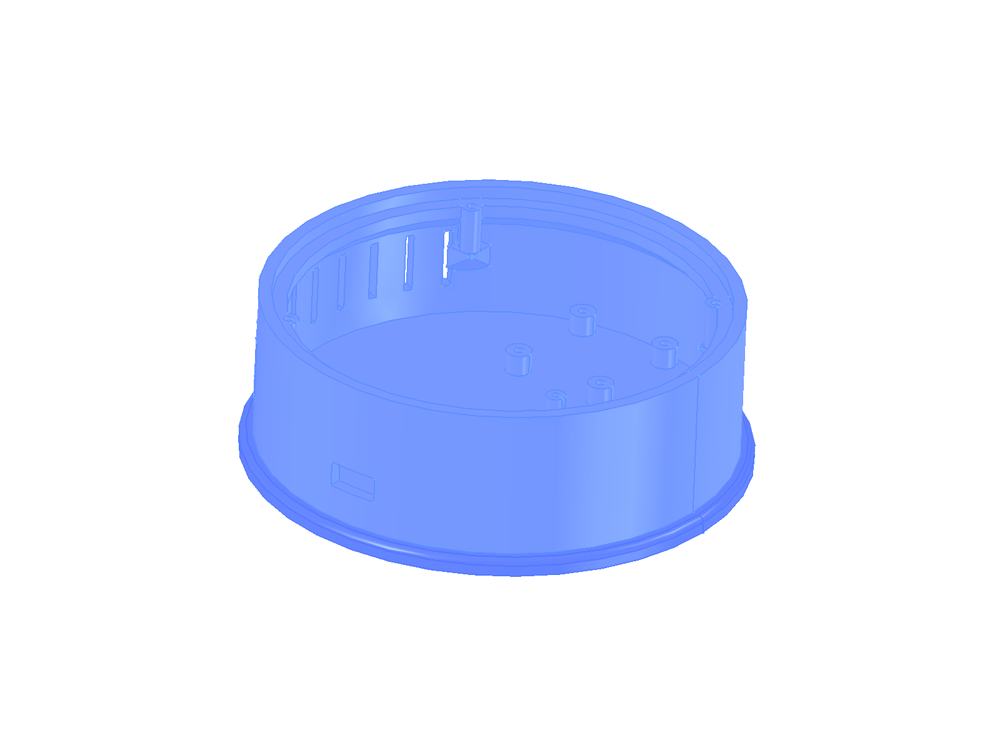
- Đặt `Base_housing` lên `Base_foot`. Cách cố định chân đế: **TODO** (model không có vít).

## Bước 2 – Điện tử và servo xoay đế (bên trong vỏ đế)
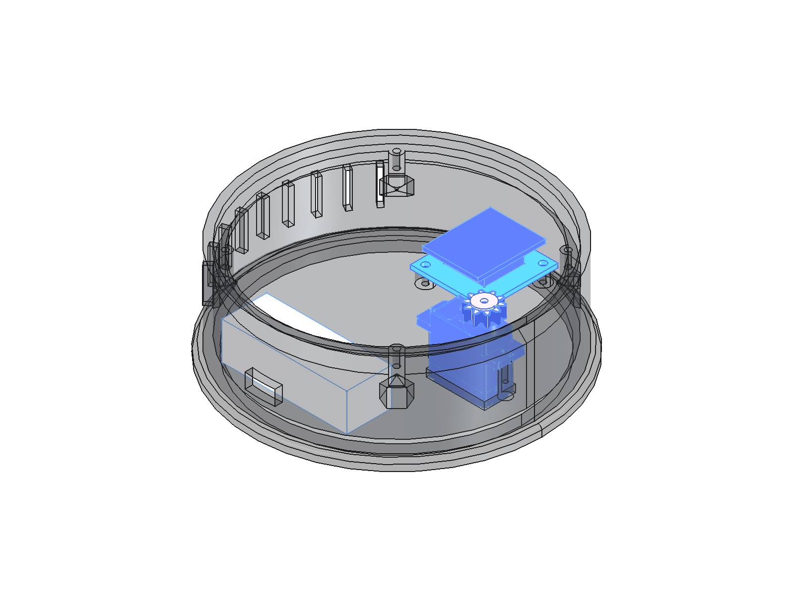
- Đặt `Battery_bay` vào vỏ đế. Đặt 4 `Receiver_riser` (ống nâng in, cao 9,7 mm) lên 4 trụ trong vỏ đế.
- Bộ thu `CB_XA003_XA004_receiver`: lõi XA003 cắm **mặt dưới** shield XA004, header servo **hướng lên** (cắm dây được).
  Đặt lên 4 ống nâng, bắt 4 vít M2.5 dài (TODO chiều dài) xuyên shield + ống vào trụ. Lõi XA003 lọt giữa 4 ống.
- **Không** đặt shield trực tiếp lên trụ cũ: lõi XA003 sẽ cấn đáy vỏ (model cũ vẽ thiếu chiều cao shield).
- Đặt `CB_Servo9g_360_turntable` vào hốc trong vỏ đế; ép `Pinion_m1_z10_turntable` (bánh răng 10 răng) lên trục servo.
- Cách giữ servo và mạch trong vỏ: **TODO** (model không có vít/kẹp).

## Bước 3 – Cụm mâm xoay (làm NGOÀI vỏ đế)
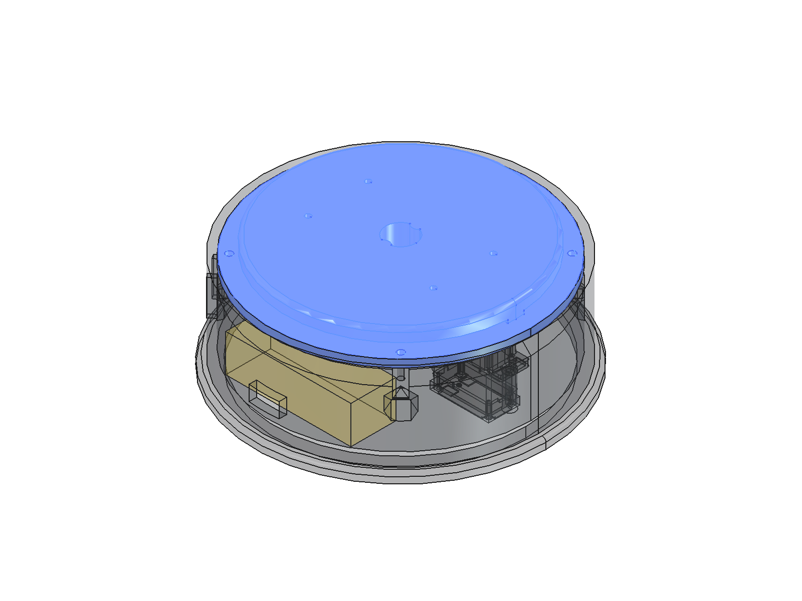
- Đặt `Slide_ring` lên `Base_deck`, đặt `Turntable` lên vòng trượt.
- **Từ dưới deck**, áp `Turntable_gear_m1_z60` vào mâm xoay và bắt **2 vít M2.5 × 10 từ dưới lên**.
  Bánh răng và mâm kẹp deck ở giữa – phải làm bước này trước khi bắt deck vào vỏ (sau đó không với tới mặt dưới).

## Bước 4 – Gắn cụm mâm xoay lên đế
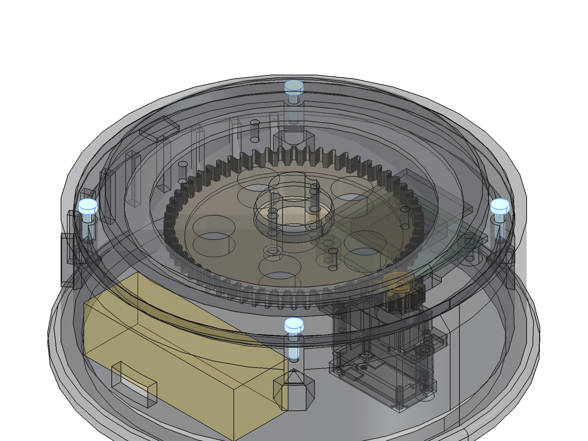
- Hạ cụm bước 3 xuống vỏ đế sao cho **bánh răng z60 ăn khớp bánh răng 10 răng** của servo.
- Bắt **4 vít M2.5 × 8 từ trên xuống** qua deck vào 4 vấu trong vỏ đế. Xoay thử mâm bằng tay: phải êm, không kẹt.

## Bước 5 – Turret
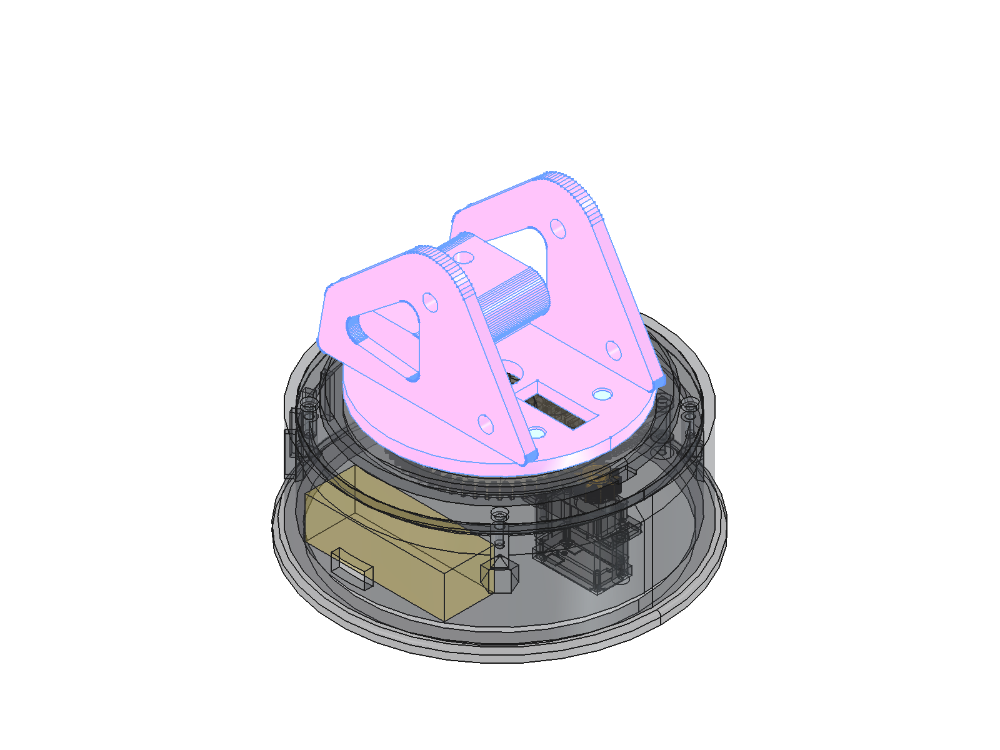
- Đặt `Turret_one_piece` lên mâm xoay; bắt **4 vít M2.5 × 6 từ trong turret xuống** mâm.

## Bước 6 – Hai cụm xi-lanh (vai và khuỷu, làm giống nhau)
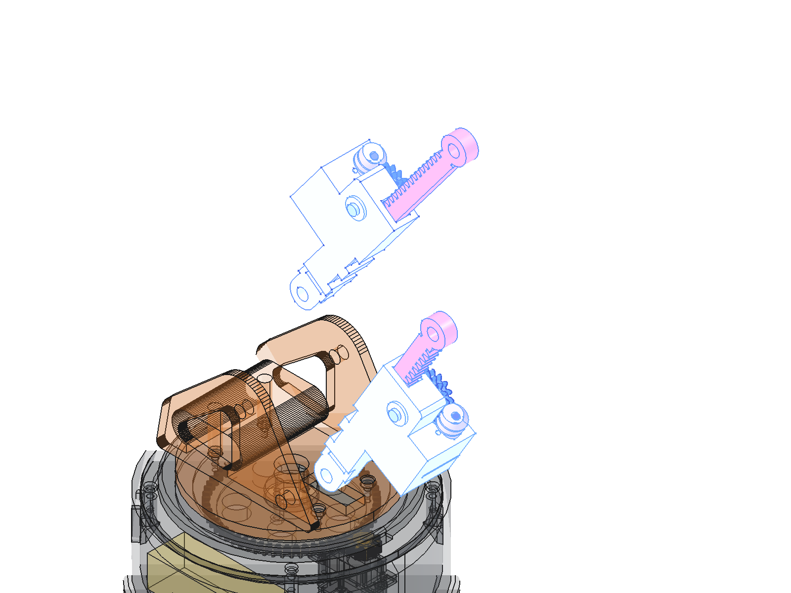
- **An toàn động cơ 030 (datasheet LA024):** 5–9 V; **không để kẹt trục khi đang cấp điện** (nóng, có thể cháy);
  thử tay toàn hành trình trước khi cấp nguồn. Lực dọc trục (trục vít) hại động cơ → gối chặn cuối trục vít phải có.
- Lắp hộp số 030 theo hướng dẫn của hãng (`Assembly_Guide_of_Single_Axis_030_Reduction_Motor.pdf`), bôi mỡ bánh răng.
- Đặt `Pinion_WormWheel_*` (bánh vít + bánh răng) vào vỏ; từ phía ngoài lắp `Washer_shaft_*` rồi **vít M2.5 × 6**
  vào tâm bánh vít. Washer cố ý hở 0,1–0,2 mm – bánh vít phải quay tự do.
- Cắm `Worm_*` (trục vít, đầu có lỗ vát 2 mặt) **vào trục ra hộp số** (xoay cho mặt vát khớp, không ép mạnh).
- Đẩy **cả cụm hộp số + trục vít từ bên hông** (phía động cơ chĩa ra) vào ổ trên vỏ: moay-ơ trục vít trượt theo
  rãnh chữ U, răng trục vít trượt vào răng bánh vít. Đầu trục vít tì nhẹ vào gối chặn (hở 0,3 mm).
- Khoá hộp số: đẩy 2 chốt `Pin_gearbox_*` (đầu to ra ngoài) qua 2 lỗ trên thành vỏ vào 2 lỗ Ø4 của nắp hộp số.
- Luồn thanh răng `Rack_*` qua vỏ (rãnh hở 0,3 mm), ăn khớp bánh răng. Đẩy kéo tay thử: hết hành trình không kẹt.
- Tỉ số: STEP hãng ≈ 45,5:1 (gần kit LA016 1:48) × trục vít 16:1 – mã kit thật: **TODO** (tốc độ/lực xi-lanh đổi theo).

## Bước 7 – Cần chính (Boom) lên turret – chốt S
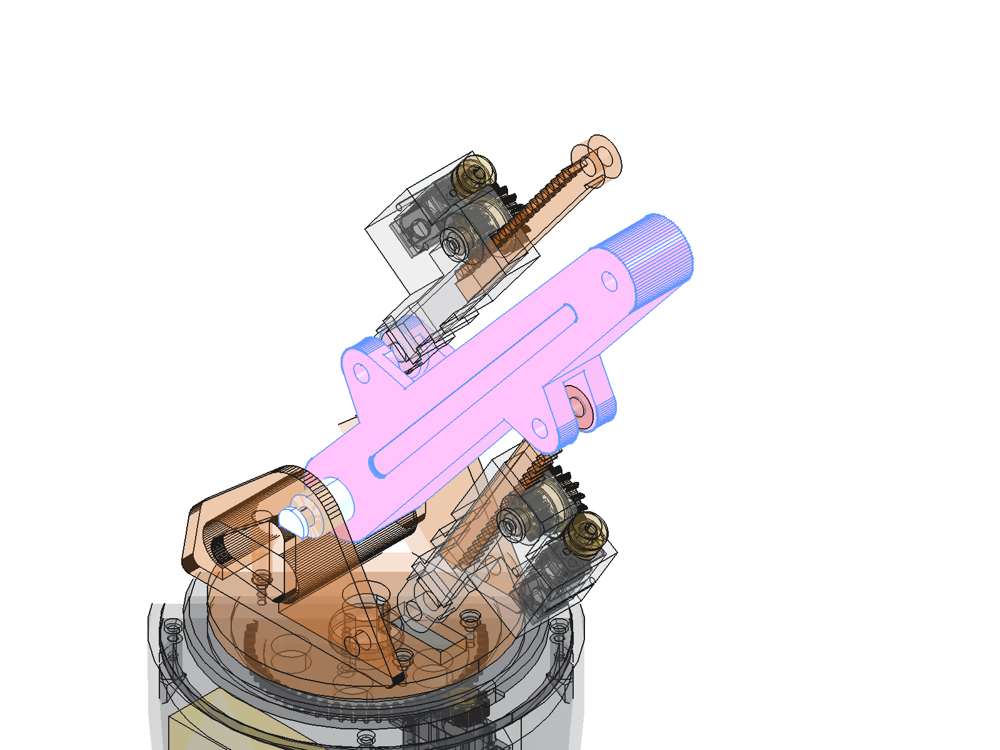
- **Khớp số 1.** Đặt `Boom001` vào giữa 2 tai turret, mỗi bên một `Spacer_S`.
- Luồn `Pin_S` xuyên qua tai turret – đệm – Boom – đệm – tai turret; đầu kia lắp `Pin_S_washer` + **vít M2.5 × 6**.

## Bước 8 – Xi-lanh vai – chốt A và B
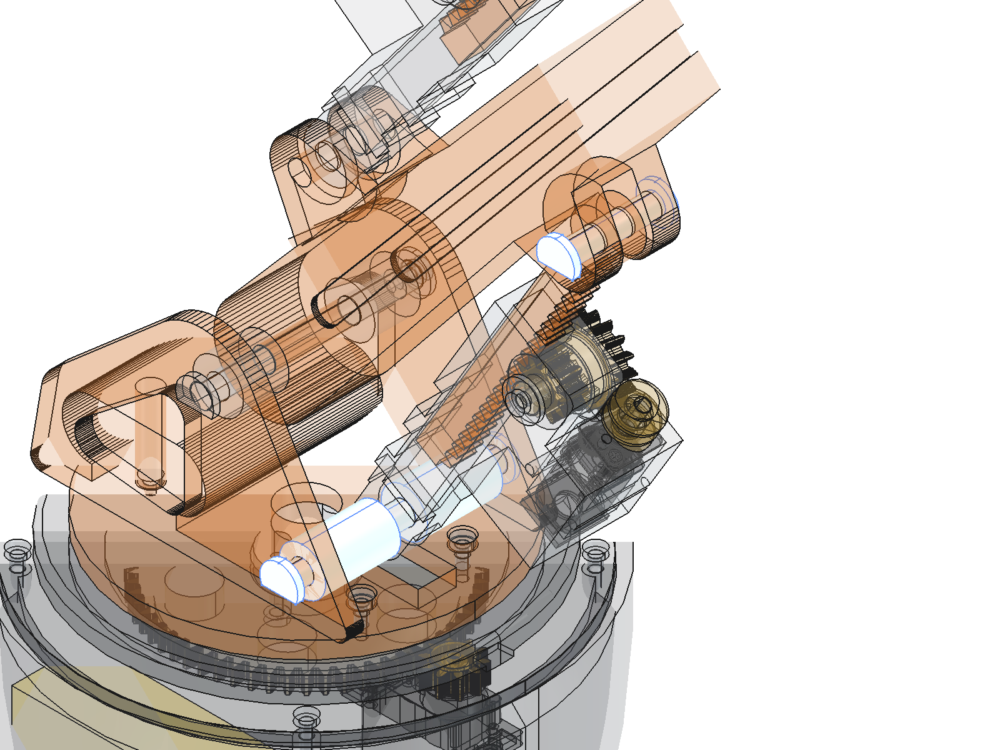
- **Chốt A – số 2 (khắc trên vỏ):** tai `Housing_Shoulder` vào giữa 2 tai turret, mỗi bên một `Spacer_A`; luồn `Pin_A`, khóa washer + vít M2.5 × 6.
- **Chốt B – số 3:** đầu thanh răng `Rack_Shoulder` vào Boom; luồn `Pin_B`, khóa washer + vít M2.5 × 6.

## Bước 9 – Cụm cẳng tay (Forearm)
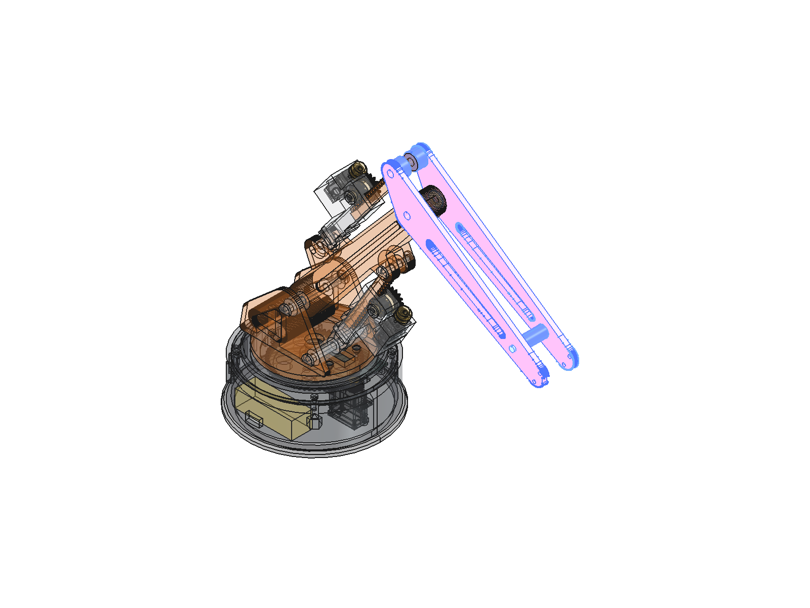
- Ghép `Forearm_plate_L` và `Forearm_plate_R` với `Wrist_spacer` ở giữa: **2 vít M2.5 × 6**, mỗi tấm một vít từ ngoài vào.
- Đặt sẵn `Spacer_D` và `Spacer_E` (mỗi cái gồm 2 miếng) vào lỗ chốt D và E giữa 2 tấm.

## Bước 10 – Cẳng tay lên Boom – chốt E (khuỷu)
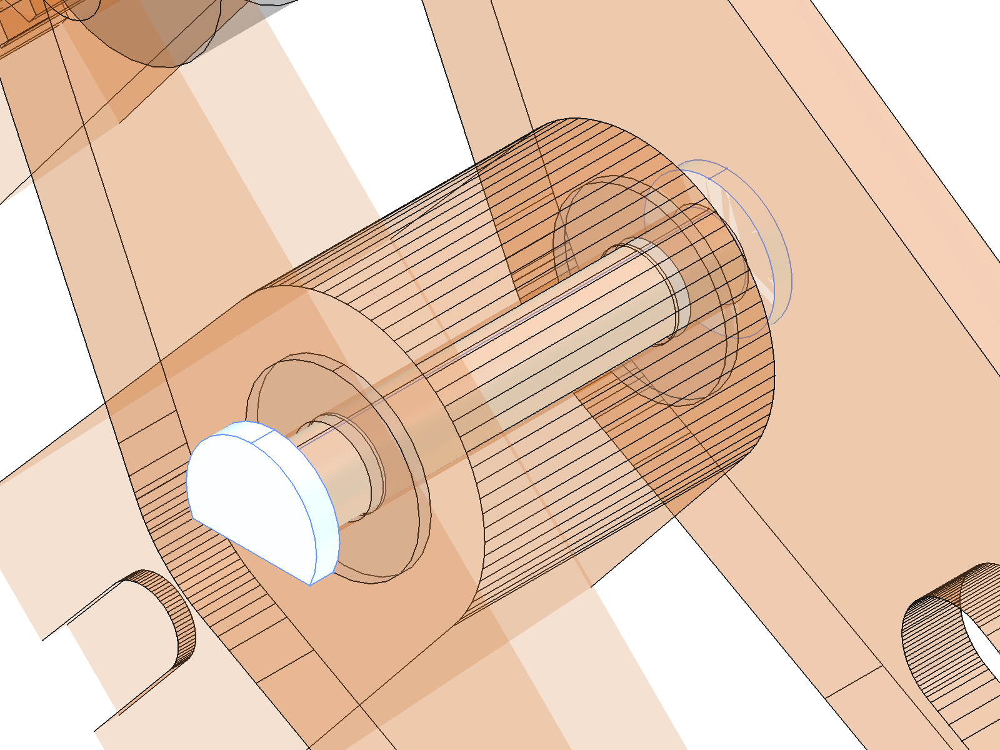
- **Khớp số 4.** Kẹp đầu Boom vào giữa 2 tấm cẳng tay (đệm `Spacer_E`); luồn `Pin_E`, khóa washer + vít M2.5 × 6.

## Bước 11 – Xi-lanh khuỷu – chốt C và D
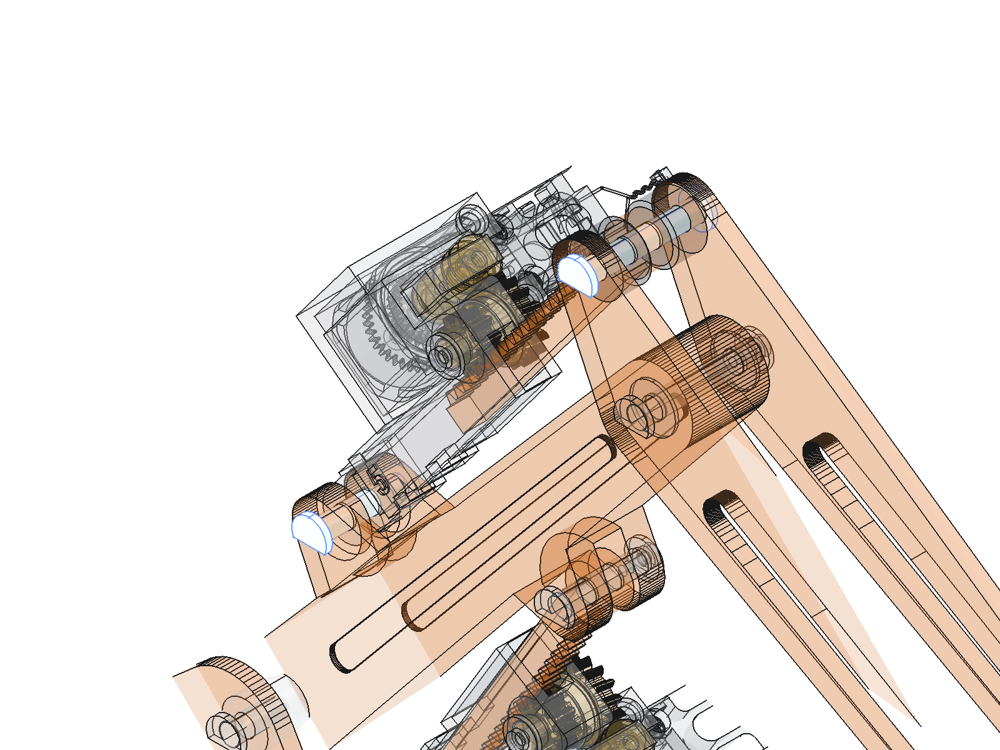
- **Chốt C – số 5 (khắc trên vỏ):** tai `Housing_Elbow` vào Boom; luồn `Pin_C`, khóa washer + vít M2.5 × 6.
- **Chốt D – số 6:** đầu thanh răng `Rack_Elbow` vào giữa 2 tấm cẳng tay (đệm `Spacer_D`); luồn `Pin_D`, khóa washer + vít.

## Bước 12 – Cụm kẹp (làm riêng)
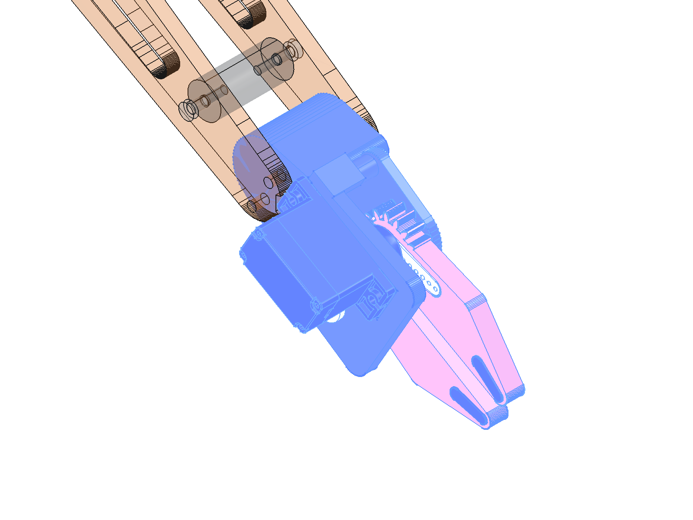
- Đặt `CB_Servo9g_180_gripper` vào hốc `Gripper_frame` (khe 0,2 mm).
- Đưa servo về **vị trí giữa** trước khi gắn horn (khuyến nghị chung khi lắp servo), ép `Servo_horn` lên trục, gắn
  `Jaw_1_driven_by_servo` lên horn. Vít horn: TODO (thường đi kèm servo).
- Cắm `Pin_jaw2` vào khung, lồng `Spacer_jaw2` rồi `Jaw_2_idler`; răng của 2 hàm phải ăn khớp (khe răng 0,14 mm).
- Đậy `Gripper_top_plate`: **2 vít M2.5 × 6** vào khung; khóa đầu chốt hàm bằng `Washer_pin` + **vít M2.5 × 6**.
- Gắn 2 đệm TPU (`*_TPU_pad`) vào mặt kẹp của 2 hàm. Cách gắn: **TODO** (dán / ép).

## Bước 13 – Kẹp lên cẳng tay
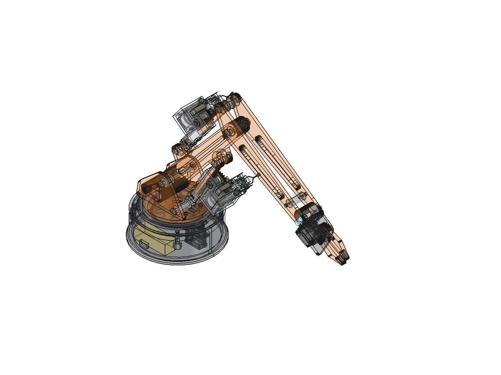
- Đưa khung kẹp vào giữa 2 tấm cẳng tay; **4 vít M2.5 × 6**, mỗi bên 2 vít.

## Sau khi lắp
- Xoay tay từng khớp bằng tay (chưa cấp điện): không kẹt, không cạ. Tầm hoạt động thiết kế: xem macro
  `freecad/pushrod_arm_sim.FCMacro` (xi-lanh vai 92–118 mm, khuỷu 92–128 mm, kẹp −55…+3°, đế ±170°).
- Đấu dây động cơ 030 ×2 (SH1.0 2P, cổng motor XA004, ≤ 1 A/cổng), servo ×2 (header 3 chân): cổng nào cho khớp nào **TODO**.
- Cấp điện lần đầu: chạy chậm, theo dõi nhiệt động cơ 030 (trục vít tự hãm – kẹt cơ khí sẽ tăng dòng, không để kẹt).
- In xong và lắp xong: ghi kết quả bằng `/print-result pushrod-arm <plate> pass|fail`.
