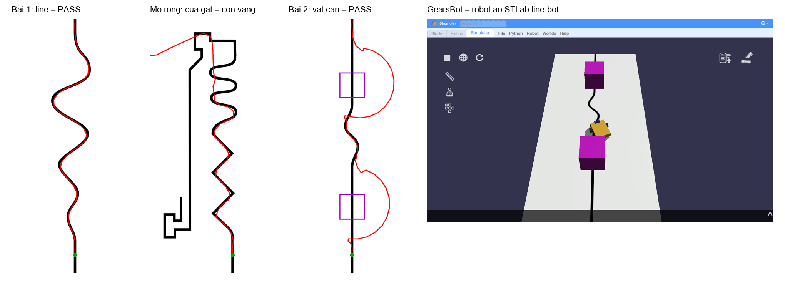

# GearsBot – robot ảo STLab line-bot

Bộ file để học sinh **lắp robot ảo → lập trình → chạy mô phỏng** trên [GearsBot](https://gears.aposteriori.com.sg)
trước khi lắp `maker/line-bot` thật. GearsBot chạy trong trình duyệt, không cần cài đặt, không cần tài khoản.
Mã nguồn GearsBot (GPL-3.0) được ghim tại `community/quirkycort-gears/`. Giáo án: [stlab/lesson-plans/gearsbot-virtual-line-bot.md](../../lesson-plans/gearsbot-virtual-line-bot.md).

## Link mở sẵn (robot + sa bàn)

| Bài | Link |
|---|---|
| Line đơn giản | [mở](https://gears.aposteriori.com.sg/index.html?worldJSON=https%3A%2F%2Fraw.githubusercontent.com%2Fathanhtuan11%2FSTLAB_Toolhub%2Fmain%2Fclaude-workspace%2Fstlab%2Fsimulation%2Fgearsbot%2Fline-simple.world.json&robotJSON=https%3A%2F%2Fraw.githubusercontent.com%2Fathanhtuan11%2FSTLAB_Toolhub%2Fmain%2Fclaude-workspace%2Fstlab%2Fsimulation%2Fgearsbot%2Fstlab-line-bot.robot.json) |
| Cua gắt (mở rộng) | [mở](https://gears.aposteriori.com.sg/index.html?worldJSON=https%3A%2F%2Fraw.githubusercontent.com%2Fathanhtuan11%2FSTLAB_Toolhub%2Fmain%2Fclaude-workspace%2Fstlab%2Fsimulation%2Fgearsbot%2Fline-sharp.world.json&robotJSON=https%3A%2F%2Fraw.githubusercontent.com%2Fathanhtuan11%2FSTLAB_Toolhub%2Fmain%2Fclaude-workspace%2Fstlab%2Fsimulation%2Fgearsbot%2Fstlab-line-bot.robot.json) |
| Vật cản 20 × 20 cm | [mở](https://gears.aposteriori.com.sg/index.html?worldJSON=https%3A%2F%2Fraw.githubusercontent.com%2Fathanhtuan11%2FSTLAB_Toolhub%2Fmain%2Fclaude-workspace%2Fstlab%2Fsimulation%2Fgearsbot%2Fline-obstacles.world.json&robotJSON=https%3A%2F%2Fraw.githubusercontent.com%2Fathanhtuan11%2FSTLAB_Toolhub%2Fmain%2Fclaude-workspace%2Fstlab%2Fsimulation%2Fgearsbot%2Fstlab-line-bot.robot.json) |

Không có mạng thì dùng menu **Robot → Load robot from file** và **Worlds → Load world from file** với các file trong thư mục này.

## File

| File | Nội dung |
|---|---|
| `stlab-line-bot.robot.json` | Robot ảo: thân 170 × 135 mm, bánh Ø42 mm, khổ ngoài 177 mm (≤ 180 mm như `maker/line-bot`), cảm biến màu trái/phải cách nhau 40 mm, đặt trước trục bánh 60 mm, siêu âm phía trước. Cổng: A bánh trái, B bánh phải, 1 màu trái, 2 màu phải, 3 siêu âm. |
| `line-simple.world.json`, `line-sharp.world.json`, `line-obstacles.world.json` | Sa bàn có sẵn của GearsBot (Line Following: Simple / Sharp Turns / Obstacles 1), 100 × 200 cm. |
| `solutions/00-one-sensor.py` | Chương trình mẫu buổi 1 (phát cho học sinh): 1 cảm biến, zigzag mép line – dùng để thử vị trí cảm biến. |
| `solutions/01-line-follow.py` | Lời giải mẫu (giáo viên): dò line 2 cảm biến, điều khiển tỉ lệ P. |
| `solutions/02-line-follow-avoid.py` | Lời giải mẫu: dò line + tránh vật cản bằng siêu âm, xoay theo encoder rồi chạy cung tròn. |
| `review/` | Ảnh kiểm tra (contact sheet + quỹ đạo vẽ trên sa bàn). |
| `check/run_sim.py` | Chạy thử tự động cả 3 bài, báo PASS/FAIL + ảnh. |

## Đã chạy thử (2026-11-11, GearsBot @ `a393629`, Edge headless)

| Bài | Kết quả |
|---|---|
| Line đơn giản + `00` (1 cảm biến) | PASS (zigzag mép line) |
| Line đơn giản + `01` | PASS: bám line hết sa bàn |
| Cua gắt + `01` | Bám zigzag và cua chữ S, **văng ở vòng kẹp tóc**. Đây là nhiệm vụ mở rộng: chỉnh `KP` và `TOC_DO` |
| Vật cản + `02` | PASS: vòng qua 2 khối, về lại line, chạy tới cuối |



## Khác biệt ảo – thật (nói rõ với học sinh)

| Ảo (GearsBot) | Thật (`maker/line-bot`) |
|---|---|
| Cảm biến màu đặt cách sân **28 mm** (thấp hơn thì GearsBot đọc ra 0) | QTR-8 tối ưu ở **3 mm**, tối đa 6 mm; cảm biến màu theo datasheet module (`TODO` chọn module) |
| 2 cảm biến màu đo độ sáng | Mảng 8 mắt IR (QTR-8) + 2 cảm biến màu đọc dấu xanh |
| Cảm biến lý tưởng, không bị ánh sáng phòng làm nhiễu | IR bị đèn/nắng làm nhiễu, phải hiệu chỉnh trắng/đen |
| Bánh, motor giống hệt nhau | 2 motor N20 chạy lệch nhau; cần encoder + hiệu chỉnh |
| Bánh Ø42 mm, khối lượng 1,0 kg + bánh | Bánh `TODO` (đang giả định Ø42 theo `params.json`); khối lượng mục tiêu ≤ 1,2 kg |
| Lập trình Python kiểu ev3dev2 | Firmware C++ trên Arduino Mega 2560 (cùng thuật toán) |

## Kiểm lại sau khi đổi file

```bash
python stlab/simulation/gearsbot/check/run_sim.py            # cả 4 bài, ~8 phút
python stlab/simulation/gearsbot/check/run_sim.py simple     # 1 bài: one | simple | sharp | obstacles
```

Script tự bật server cục bộ, mở GearsBot (bản ghim) bằng Edge headless, nạp robot + world + lời giải, chạy, vẽ quỹ đạo
vào `review/trace-*.png`. PASS = robot tới cuối sa bàn (z ≥ 95 cm) mà không ra ngoài mép. Cần Python có
`websocket-client` + Pillow (Python hệ thống đã có). Máy render bằng phần mềm nên mô phỏng chậm hơn thời gian thật.

Bằng tay: mở link ở trên, dán lời giải từ `solutions/` vào tab Python, bấm ▶ trong tab Simulator.
